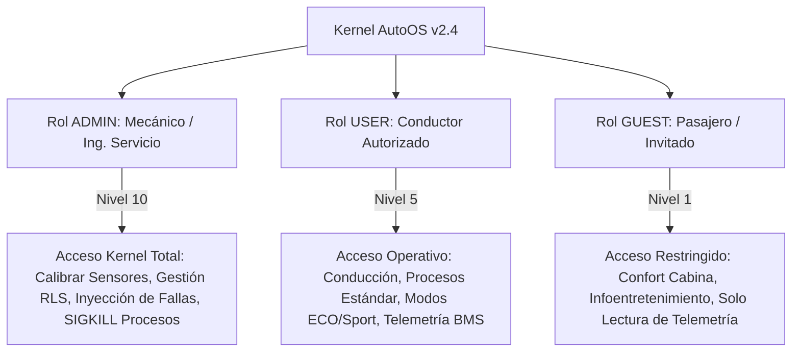
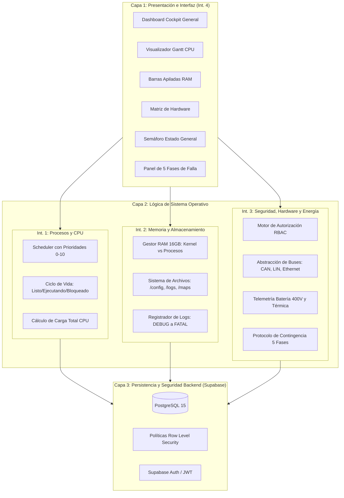
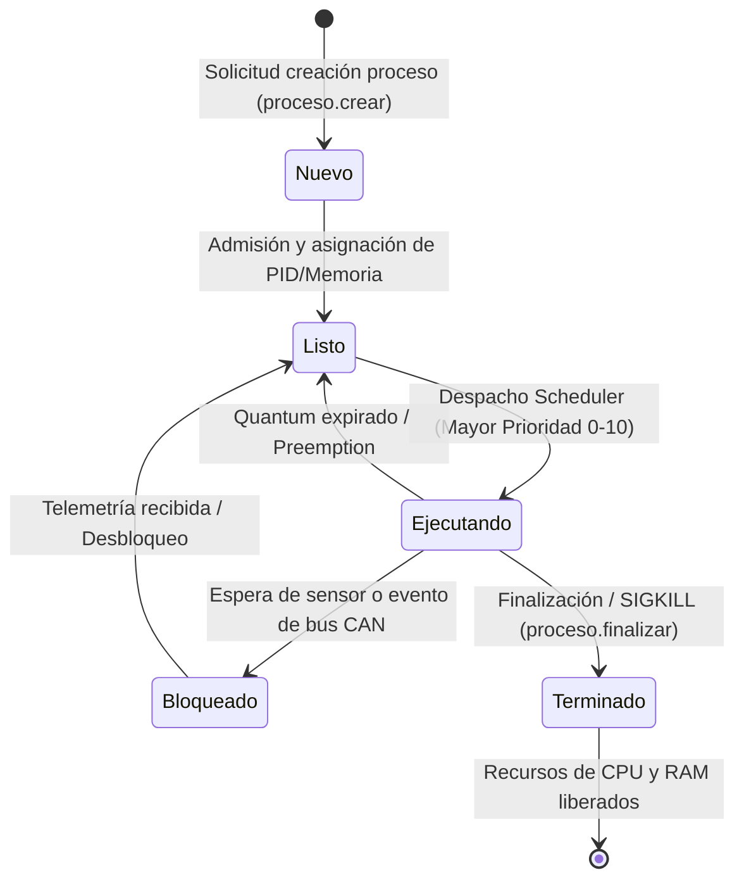
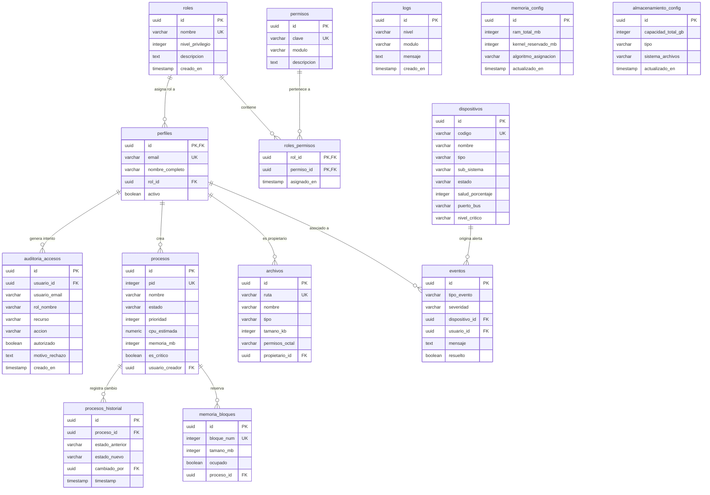

# AUTOOS: SISTEMA OPERATIVO PARA VEHÍCULO INTELIGENTE
# DOCUMENTO DE ARQUITECTURA Y ESPECIFICACIÓN TÉCNICA MAESTRA
> **Responsable de Ensamble e Integración:** Integrante 4 (Interfaz e Integración)  
> **Equipo de Desarrollo:** 4 Integrantes  
> **Versión:** 2.4-RT | **Materia:** Sistemas Operativos  
> **Stack:** Python, Streamlit, Supabase (PostgreSQL + RLS), Plotly  

---

## 1. INTRODUCCIÓN Y DEFINICIÓN DEL PROBLEMA

### 1.1 Contexto Automotriz y Problemática
Los vehículos modernos integran simultáneamente sistemas críticos de conducción autónoma (*ADAS*), control por cable (*By-Wire*), gestión de baterías de alto voltaje (*BMS*), conectividad en la nube (*V2X*) e infoentretenimiento para los ocupantes.

El problema central que aborda **AutoOS** es la **coexistencia segura de tareas de tiempo real crítico con funciones de confort y conectividad abierta**. Un fallo o consumo desmedido de recursos por parte de un proceso de entretenimiento (ej. streaming de música) no debe, bajo ninguna circunstancia, degradar el tiempo de respuesta del sistema de frenos antibloqueo (ABS) ni del actuador de dirección asistida (ASIL-D / ISO 26262).

### 1.2 Objetivos de AutoOS
1. **Garantizar la Seguridad Funcional:** Planificador preventivo con prioridades de tiempo real (0 = Tiempo Real Crítico, 10 = Ocioso/Confort).
2. **Control de Acceso Riguroso (Autenticación ≠ Autorización):** Modelo RBAC respaldado por políticas Row Level Security (RLS) en Supabase para evitar operaciones no autorizadas.
3. **Supervisión Continua de Recursos y Hardware:** Monitoreo en tiempo real de CPU, memoria RAM (16 GB simulados), almacenamiento SSD (512 GB) y estado del paquete LiFePO4 de 400V.
4. **Respuesta Automática a Incidentes (5 Fases):** Capacidad de degradación controlada (*Fail-Safe*) ante sensores defectuosos, sobrecalentamiento o agotamiento de batería.

---

## 2. USUARIOS, PERFILES Y MODELO DE SEGURIDAD (RBAC)

AutoOS implementa el principio de **Privilegio Mínimo** dividiendo el acceso en tres identidades funcionales:

### 2.1 Matriz de Permisos por Rol

| Permiso | Módulo | Descripción | Admin | User | Guest |
| :--- | :--- | :--- | :---: | :---: | :---: |
| `proceso.crear` | Procesos | Iniciar nuevo proceso en el SO | ✅ | ✅ | ❌ |
| `proceso.listar` | Procesos | Consultar procesos en ejecución | ✅ | ✅ | ✅ |
| `proceso.cambiar_estado` | Procesos | Pausar/reanudar tareas del vehículo | ✅ | ✅ | ❌ |
| `proceso.finalizar` | Procesos | Abortar procesos (SIGKILL) | ✅ | ✅* | ❌ |
| `proceso.priorizar_tiempo_real` | Procesos | Asignar prioridad de nivel 0 (RT) | ✅ | ❌ | ❌ |
| `dispositivo.consultar` | Hardware | Inspeccionar estado de sensores/buses | ✅ | ✅ | ✅ |
| `dispositivo.calibrar` | Hardware | Calibrar LiDAR, Radar y Cámaras ADAS | ✅ | ❌ | ❌ |
| `dispositivo.desconectar` | Hardware | Interrupción física de bus CAN/Ethernet | ✅ | ❌ | ❌ |
| `dispositivo.inyectar_fallo` | Hardware | Simulación de avería de periférico | ✅ | ❌ | ❌ |
| `seguridad.admin_usuarios` | Seguridad | Administrar usuarios y roles | ✅ | ❌ | ❌ |
| `seguridad.ver_auditoria` | Seguridad | Consultar registros de acceso denegado | ✅ | ❌ | ❌ |
| `telemetria.ver_bateria` | Energía | Inspeccionar SoC, voltaje y celdas BMS | ✅ | ✅ | ✅ |
| `telemetria.modo_eco` | Energía | Forzar modo de ahorro energético | ✅ | ✅ | ❌ |
| `cabina.control_clima` | Confort | Ajuste de climatización y ventilación | ✅ | ✅ | ✅ |
| `cabina.control_multimedia` | Confort | Reproducción de audio y navegación | ✅ | ✅ | ✅ |

*\*Nota: El usuario Conductor (`user`) no puede abortar procesos con bandera `critico = True` (ASIL-D).*

---

## 3. ARQUITECTURA GENERAL DEL SISTEMA Y COMPONENTES

La arquitectura de AutoOS se organiza en cuatro capas modulares coordinadas por los cuatro integrantes del equipo:

### 3.1 Detalle de Módulos por Integrante

#### Integrante 1: Procesos, Scheduler y Estados
AutoOS implementa un modelo de 5 estados para los procesos del vehículo:

- **Scheduler por Prioridad Preventivo:** Las tareas de seguridad dinámica (ABS, Dirección EPS, BMS) operan con prioridad 0-1 (Tiempo Real Estricto), mientras que las tareas de usuario y confort operan con prioridades 3-10.
- **Modelo de Datos:** Tablas `procesos` (PID, nombre, prioridad, CPU %, RAM MB, crítico) y `procesos_historial` (trazabilidad de transiciones de estado con usuario y timestamp).

#### Integrante 2: Memoria, Archivos y Logs
- **Gestión de Memoria RAM:** Simulación de 16 GB totales (16384 MB). El Kernel RTOS reserva de manera estática e inviolable 2048 MB. El remanente se asigna mediante bloques dinámicos (`memoria_bloques`).
- **Sistema de Archivos Virtual:** Estructura jerárquica con carpetas raíz `/config`, `/logs`, `/media`, `/maps` y `/telemetry`, con permisos octales específicos según el rol.
- **Trazabilidad y Logs:** Registro centralizado en tabla `logs` categorizado en 5 niveles: `DEBUG`, `INFO`, `WARN`, `ERROR`, `FATAL`.
- **Modelo de Datos:** Tablas `memoria_bloques`, `memoria_config`, `archivos`, `almacenamiento_config`, `logs`.

#### Integrante 3: Seguridad, Dispositivos y Redes Vehiculares
- **Abstracción de Hardware (HAL):** Gestión de 10 dispositivos mapeados en buses CAN 2.0B, LIN y Automotive Ethernet, con estados: `operativo`, `degradado`, `falla` y `desconectado`.
- **Control de Acceso (RBAC + RLS):** 13 permisos en 5 módulos, validación obligatoria con `validar_accion()` y políticas a nivel de fila en Supabase.
- **Telemetría BMS y 5 Fases de Incidentes:** Supervisión térmica del paquete LiFePO4 de 400V y ejecución del protocolo de 5 fases ante averías críticas.
- **Modelo de Datos:** Tablas `roles`, `permisos`, `roles_permisos`, `perfiles`, `dispositivos`, `eventos`, `auditoria_accesos`.

#### Integrante 4: Interfaz, Integración y Visualizaciones
- **Cockpit Unificado:** Dashboard reactivo en Streamlit con diseño dark automotriz.
- **Visualizaciones Técnicas:** Tacómetros circulares Plotly, Diagrama de Gantt para CPU, gráfico Donut de procesos por estado, barra apilada horizontal de memoria RAM y Semáforo vehicular integral.
- **Despliegue y Validación:** Orquestación en Streamlit Cloud con sincronización en Supabase Cloud.

---

## 4. DIAGRAMA ENTIDAD-RELACIÓN (SUPABASE / POSTGRESQL)

El modelo de datos relacional consta de 14 tablas normalizadas sin colisiones de nombres, con llaves foráneas protegidas mediante `ON DELETE SET NULL` o `ON DELETE CASCADE`:

### 4.1 Verificación de No Colisión y Políticas RLS
1. **Evitación de Recursión Infinita en RLS:** La función de base de datos `fn_obtener_rol_actual()` fue declarada como `SECURITY DEFINER` y `STABLE`, permitiendo consultar el rol del usuario autenticado sin provocar llamadas circulares en las políticas de la tabla `perfiles`.
2. **Preservación de Trazabilidad Forense:** Todas las referencias a usuarios en `auditoria_accesos`, `eventos` y `procesos_historial` usan `ON DELETE SET NULL`, garantizando que si una cuenta es removida, el historial de seguridad no desaparezca.
3. **Aislamiento por Severidad:** La política RLS sobre la tabla `eventos` restringe la lectura a usuarios invitados (`guest`), quienes únicamente pueden ver eventos de nivel `info` y `advertencia`, ocultando alertas críticas internas del tren motriz.

---

## 5. PROTOCOLO DE INCIDENTES EN 5 FASES (FASE 10)

Ante cualquier situación anómala en la telemetría, AutoOS ejecuta de forma determinística la secuencia de 5 fases exigida por la especificación:

1. **Detección:** El controlador de bus (CAN/Ethernet) identifica lecturas erráticas o fuera de rango (ej. Código DTC U0129-87 por error de redundancia cíclica en LiDAR).
2. **Registro:** El incidente se inserta de forma inmutable en `eventos` con severidad `critico` o `emergencia`.
3. **Alerta:** El semáforo general conmuta a **ROJO**, emitiendo señal acústica y visual en el HUD del Cockpit.
4. **Priorización:** El scheduler promueve tareas de frenado (`adas_collision_avoidance`) a prioridad de tiempo real 0 y suspende tareas de confort (`infotainment_media_player`).
5. **Respuesta Fail-Safe:** Se conmuta a la capa de respaldo secundario (ej. control por radar/cámaras con velocidad restringida a 60 km/h o parada segura en el arcén).
