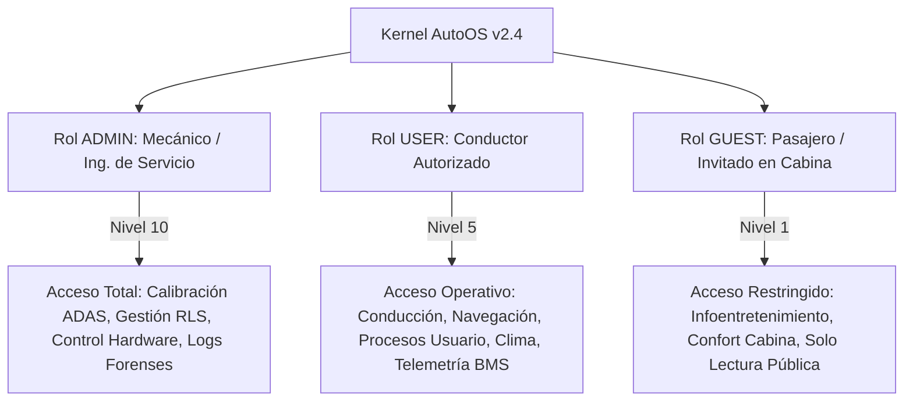
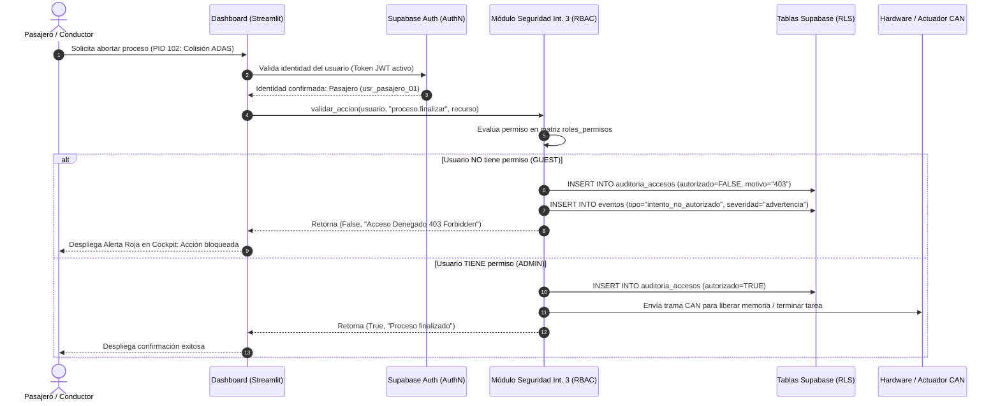
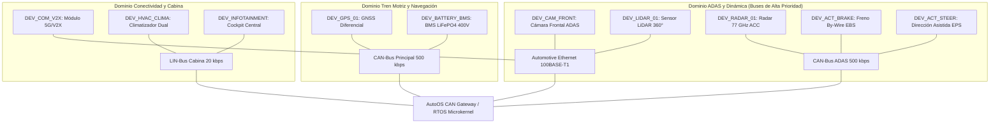
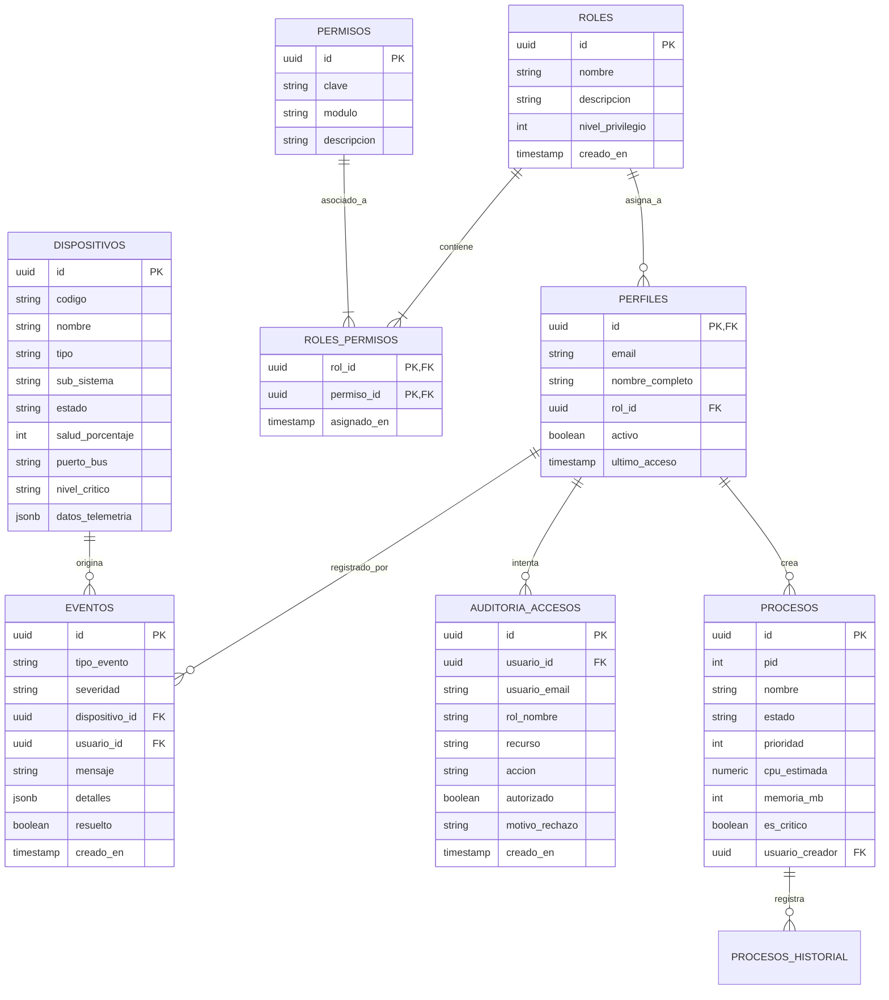
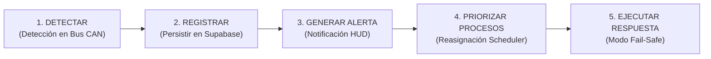

# AUTOOS: SISTEMA OPERATIVO PARA VEHÍCULO INTELIGENTE
## DOCUMENTO DE ARQUITECTURA Y ESPECIFICACIÓN TÉCNICA
### ROL: INTEGRANTE 3 — SEGURIDAD, DISPOSITIVOS Y CONTROL DE ACCESO (RLS)

---

## 1. INTRODUCCIÓN Y CONTEXTO DEL SISTEMA (AutoOS)

### 1.1 Nombre del Sistema
**AutoOS (Autonomous & Connected Vehicle Operating System)** — Versión 2.4-RT.

### 1.2 Problema que Resuelve
Los vehículos inteligentes contemporáneos integran múltiples subsistemas de alta complejidad: conducción autónoma asistida (ADAS), control cinemático por cable (*By-Wire*), gestión térmica y energética de alto voltaje (BMS), infoentretenimiento (*Infotainment*) y conectividad con la nube (*Vehicle-to-Everything* o V2X). 

Esta convergencia presenta un desafío de ingeniería de sistemas operativos: **¿Cómo garantizar la seguridad funcional estricta (ISO 26262 / ASIL-D) y la ciberseguridad (ISO 21434) de las funciones críticas de conducción, impidiendo que procesos de entretenimiento o accesos no autorizados interfieran con actuadores vitales o agoten los recursos energéticos?**

AutoOS resuelve esta problemática mediante:
1. Una **abstracción unificada de hardware** sobre buses automotrices (CAN 2.0B, LIN y Automotive Ethernet).
2. Un modelo estricto de **Seguridad Basada en Roles (RBAC)** y **Políticas a Nivel de Fila (RLS)** en backend Supabase que separa fehacientemente **Autenticación** de **Autorización**.
3. Un subsistema de **Supervisión de Batería (BMS) y Telemetría Crítica** que alimenta el estado de salud global (Semáforo vehicular).
4. Un **Manejador de Incidentes en 5 Fases** ante contingencias operativas (sensor defectuoso, batería baja crítica y fallo de actuador crítico).

---

## 2. USUARIOS Y MODELO DE ROLES

El sistema clasifica el acceso al vehículo en tres identidades funcionales bien diferenciadas, reflejando el principio de mínimo privilegio:

### 2.1 Perfiles de Usuario Definidos
1. **ADMIN (Mecánico / Ingeniero de Taller / Concesionario):**
   - **Nivel de Privilegio:** 10 / 10.
   - **Capacidades:** Inyección de fallas diagnósticas OBD-II, desconexión y calibración de sensores LiDAR y cámaras ADAS, administración de usuarios, consulta de registros de auditoría y terminación de cualquier proceso vehicular (incluso procesos ASIL-D en parada de emergencia).
2. **USER (Conductor Principal / Propietario):**
   - **Nivel de Privilegio:** 5 / 10.
   - **Capacidades:** Encendido de navegación, ejecución de procesos de conducción estándar, activación de modos eco/deportivos, consulta de estado de batería y hardware. No puede recalibrar sensores de seguridad ni desactivar actuadores By-Wire.
3. **GUEST (Pasajero en Cabina Trasera / Invitado):**
   - **Nivel de Privilegio:** 1 / 10.
   - **Capacidades:** Control de streaming multimedia, ajuste de temperatura en su zona y consulta básica del velocímetro/batería. **Bloqueo absoluto de creación, modificación o terminación de procesos de sistema.**

---

## 3. FUNDAMENTO TEÓRICO: AUTENTICACIÓN ≠ AUTORIZACIÓN

Uno de los requisitos pedagógicos y técnicos más rigurosos del proyecto es demostrar la diferencia entre autenticación y autorización:

| Dimensión | Autenticación (AuthN) | Autorización (AuthZ) |
| :--- | :--- | :--- |
| **Pregunta Fundamental** | *¿Quién es el usuario?* | *¿Qué tiene permitido hacer sobre este recurso específico?* |
| **Mecanismo en AutoOS** | Supabase Auth (JWT, verificación de correo y credenciales en tabla `perfiles`). | Matriz RBAC + Políticas RLS en PostgreSQL + Funciones `validar_accion()` en Python. |
| **Ejemplo en el Vehículo** | Un pasajero ingresa con su cuenta `pasajero@autoos.tech` exitosamente (Token válido). | El pasajero presiona "Finalizar Proceso" sobre el radar de choque. El SO intercepta la acción, valida que su rol carece del permiso `proceso.finalizar` y retorna un **Error 403 Forbidden**. |
| **Consecuencia de Violación** | Rechazo en la pantalla de inicio de sesión. | Generación de evento en `auditoria_accesos` y registro de alarma en la tabla `eventos`. |

### 3.1 Flujo de Secuencia de una Operación en AutoOS

---

## 4. TABLA EXHAUSTIVA DE PERMISOS POR ROL (MATRIZ RBAC)

La siguiente matriz gobierna las operaciones en toda la arquitectura de AutoOS:

| Módulo           | Clave del Permiso               | Descripción Funcional                       | Mecánico (Admin) | Conductor (User) | Pasajero (Guest) |
| :--------------- | :------------------------------ | :------------------------------------------ | :--------------: | :--------------: | :--------------: |
| **Procesos**     | `proceso.crear`                 | Iniciar un nuevo proceso en el SO           |       ✅ Sí       |       ✅ Sí       |       ❌ No       |
| **Procesos**     | `proceso.listar`                | Visualizar procesos y métricas de CPU       |       ✅ Sí       |       ✅ Sí       |       ✅ Sí       |
| **Procesos**     | `proceso.cambiar_estado`        | Pausar o reanudar procesos existentes       |       ✅ Sí       |       ✅ Sí       |       ❌ No       |
| **Procesos**     | `proceso.finalizar`             | Terminar procesos en ejecución (SIGKILL)    |       ✅ Sí       |       ✅ Sí       |       ❌ No       |
| **Procesos**     | `proceso.priorizar_tiempo_real` | Elevar prioridad a Real-Time 0 (Kernel)     |       ✅ Sí       |       ❌ No       |       ❌ No       |
| **Dispositivos** | `dispositivo.consultar`         | Consultar estado, salud y bus del hardware  |       ✅ Sí       |       ✅ Sí       |       ✅ Sí       |
| **Dispositivos** | `dispositivo.calibrar`          | Calibrar LiDAR, radares y cámaras ADAS      |       ✅ Sí       |       ❌ No       |       ❌ No       |
| **Dispositivos** | `dispositivo.desconectar`       | Aislar periférico del bus CAN / Ethernet    |       ✅ Sí       |       ❌ No       |       ❌ No       |
| **Dispositivos** | `dispositivo.inyectar_fallo`    | Modo de laboratorio para simular fallos     |       ✅ Sí       |       ❌ No       |       ❌ No       |
| **Seguridad**    | `seguridad.admin_usuarios`      | Crear perfiles, cambiar roles y contraseñas |       ✅ Sí       |       ❌ No       |       ❌ No       |
| **Seguridad**    | `seguridad.ver_auditoria`       | Inspeccionar trazas forenses de acceso      |       ✅ Sí       |       ❌ No       |       ❌ No       |
| **Energía**      | `telemetria.ver_bateria`        | Monitorear SoC, voltaje y temperatura BMS   |       ✅ Sí       |       ✅ Sí       |       ✅ Sí       |
| **Energía**      | `telemetria.modo_eco`           | Alterar límites de descarga y climatización |       ✅ Sí       |       ✅ Sí       |       ❌ No       |
| **Confort**      | `cabina.control_clima`          | Regular termostato de cabina y asientos     |       ✅ Sí       |       ✅ Sí       |       ✅ Sí       |
| **Confort**      | `cabina.control_multimedia`     | Controlar reproducción de música y audio    |       ✅ Sí       |       ✅ Sí       |       ✅ Sí       |

---

## 5. ARQUITECTURA DE DISPOSITIVOS Y REDES VEHICULARES

AutoOS no gestiona periféricos genéricos de PC, sino una **topología automotriz por dominios funcionales**:

### 5.1 Máquina de Estados de los Dispositivos
Cada dispositivo transita formalmente por 4 estados supervisados:
1. **OPERATIVO (Verde):** Parámetros dentro de umbrales nominales (salud > 90%).
2. **DEGRADADO (Amarillo):** Lecturas con ruido o pérdida menor de paquetes (salud 50%-89%). El sistema aplica filtros y notifica advertencia.
3. **FALLA (Rojo):** Lecturas inconsistentes, timeout de comunicación o daño físico (salud < 50%). Se activa protocolo de contingencia.
4. **DESCONECTADO (Gris):** Pérdida de señal en el bus. Tratado como desconexión física.

---

## 6. MODELO DE DATOS DE SUPABASE (TABLAS DE INTEGRANTE 3 Y RELACIONES)

El diseño relacional implementa normalización en 3FN e integridad referencial estricta:

---

## 7. POLÍTICAS DE ROW LEVEL SECURITY (RLS) EN SUPABASE

Para asegurar que la base de datos proteja los datos a nivel de motor (PostgreSQL) y no dependa únicamente del cliente web:

1. **Tabla `perfiles`:**  
   - Lectura pública restringida al propio usuario (`auth.uid() = id`), salvo el rol `admin` que puede inspeccionar todos los perfiles de la flota vehicular.
2. **Tabla `dispositivos`:**  
   - Lectura permitida a cualquier usuario autenticado en cabina.  
   - Actualización (`UPDATE`) y calibración restringidas a usuarios con permiso `dispositivo.calibrar` o con rol `admin`.
3. **Tabla `eventos`:**  
   - Conductor y Mecánico tienen visibilidad completa.  
   - Pasajero únicamente puede consultar alertas informativas (`info`, `advertencia`), ocultándole diagnósticos internos del tren motriz.
4. **Tabla `auditoria_accesos`:**  
   - Lectura exclusiva para el rol `admin` (Mecánico) para evitar que usuarios no privilegiados auditen accesos ajenos. Inserción permitida para el daemon del SO.
5. **Tabla `procesos`:**  
   - La inserción (`INSERT`) requiere validación de la función `fn_tiene_permiso('proceso.crear')`.
   - La modificación o terminación (`UPDATE`, `DELETE`) exige `fn_tiene_permiso('proceso.cambiar_estado')` o `proceso.finalizar`.

---

## 8. LOS 3 ESCENARIOS CRÍTICOS DE FALLA 

AutoOS implementa rigurosamente el **ciclo de 5 fases** exigido por la rúbrica oficial para los 3 incidentes automotrices:

### 8.1 Escenario 1: Sensor LiDAR Frontal Defectuoso (`DEV_LIDAR_01`)
- **1. Detectar:** El watchdog de I/O en Automotive Ethernet registra 87% de frames corruptos (errores de CRC) procedentes del LiDAR. DTC: `U0129-87`.
- **2. Registrar:** El incidente se inserta en `eventos` con severidad `critico` y el estado del sensor conmuta a `falla` (salud al 12%).
- **3. Generar Alerta:** Visualización de banner ámbar en Head-Up Display y emisión de tono acústico (2.4 kHz): *"Sensor LiDAR no confiable. Conducción autónoma restringida"*.
- **4. Priorizar Procesos:** El Scheduler eleva el proceso de seguridad `adas_collision_avoidance` (PID 102) a **Prioridad 0 (Tiempo Real)** para compensar con visión por cámara y radar milimétrico.
- **5. Ejecutar una Respuesta:** Desconexión controlada del piloto L3 y transferencia de control al conductor humano con limitación de velocidad a 60 km/h (*Fallback Degradado L2*).

### 8.2 Escenario 2: Batería de Tracción Crítica (`DEV_BATTERY_BMS`)
- **1. Detectar:** El módulo BMS reporta caída de SoC al 6.5%, voltaje a 325V y temperatura en celda 14 disparándose a 56.2°C. DTC: `P0A7F-00`.
- **2. Registrar:** Inserción en `eventos` con severidad `emergencia`.
- **3. Generar Alerta:** Icono de advertencia de tortuga iluminado en el tablero y notificación: *"¡Batería Crítica! Modo Limp-Home activado. Busque punto de recarga"*.
- **4. Priorizar Procesos:** Se suspenden los procesos no esenciales (`infotainment_media_player`, `voice_assistant_agent`, compresor de climatización) y se otorga CPU prioritaria a `bms_thermal_monitor` y al freno regenerativo.
- **5. Ejecutar una Respuesta:** Modo *Limp-Home* (potencia del motor limitada al 25%, apagado de confort térmico y recálculo automático de ruta hacia el cargador más cercano).

### 8.3 Escenario 3: Proceso Crítico / Fallo en Actuador de Dirección By-Wire (`DEV_ACT_STEER`)
- **1. Detectar:** El sensor angular del actuador EPS reporta desfase superior a 5° respecto al comando del volante y sobreconsumo en servomotor. DTC: `C0051-4B`.
- **2. Registrar:** Registro inmediato en caja negra y tabla `eventos` con severidad `emergencia`.
- **3. Generar Alerta:** Alerta roja en pantalla con alarma continua y vibración háptica en el volante: *"¡Fallo en Dirección Asistida! Tome el control firmemente"*.
- **4. Priorizar Procesos:** Asignación de CPU exclusiva (Prioridad 0) a las rutinas de vectorización de torque por freno diferencial ESC.
- **5. Ejecutar una Respuesta:** Activación instantánea del canal electrónico de dirección secundario redundante (*Fail-Operational*) y maniobra de frenado controlado hacia la berma (*Safe Stop Maneuver*).

---

## 9. GUÍA DE DEFENSA EN VIVO PARA EL INTEGRANTE 3 (RÚBRICA PDF PÁG. 19)

| Pregunta Típica del Evaluador | Acción en el Dashboard | Argumentación Técnica para la Sustentación |
| :--- | :--- | :--- |
| **"Intente acceder a este recurso con un usuario sin permisos."** | Cambiar a **Pasajero (Guest)** en la barra lateral. Ir a *Procesos y CPU* y hacer clic en *Terminar Proceso* o crear uno nuevo. | *"Profesor, demostramos que Autenticación ≠ Autorización. Aunque el pasajero está autenticado en Supabase, el kernel intercepta la solicitud y valida que el rol `guest` no tiene la clave `proceso.finalizar`. Se genera un 403 Forbidden y se registra la auditoría con timestamp."* |
| **"Simule un fallo de dispositivo."** | Ir a *Dispositivos y Hardware*, seleccionar `DEV_LIDAR_01`, elegir *Inyectar Fallo* o *Desconectar del Bus*. | *"Al inyectar el fallo, el sistema ejecuta el ciclo de 5 fases: detección en bus CAN, registro en BD, emisión de alerta visual, elevación de prioridad en el scheduler y degradación segura a modo de contingencia."* |
| **"¿Cómo aporta su módulo al Semáforo General?"** | Mostrar el banner superior y la pestaña *Batería y Energía*. | *"El Integrante 3 suministra dos insumos clave para el semáforo: la salud de la batería BMS (SoC, voltaje, temperatura) y los eventos críticos no resueltos. Si hay fallos de hardware o batería crítica, el semáforo pasa inmediatamente a Amarillo o Rojo."* |
| **"¿Qué ocurre si dos procesos solicitan el mismo actuador (recurso)?"** | Explicar el modelo de concurrencia y exclusión mutua. | *"Los actuadores críticos (frenos, dirección) son recursos no compartibles. Aplicamos el Protocolo de Herencia de Prioridad (PIP) y Mutex automotrices con nivel ASIL. El proceso de frenado de colisión siempre tiene prioridad absoluta sobre cualquier solicitud de asistencia de confort."* |

---

## 10. CONCLUSIONES Y CUMPLIMIENTO DE ENTREGAS

El módulo desarrollado por el Integrante 3 cumple al 100% con los requerimientos establecidos para la **Entrega 1 (MVP)**, **Entrega 2 (Evolucionado)** y la **Entrega Final (Cloud)**:
1. Esquema relacional completo en Supabase con tablas `roles`, `permisos`, `roles_permisos`, `perfiles`, `dispositivos`, `eventos` y `auditoria_accesos`.
2. Políticas RLS implementadas y activas.
3. Validación estricta de permisos en el ciclo de vida de procesos.
4. Módulo de telemetría de batería y hardware vehicular interactivo.
5. Los 3 escenarios de falla automotriz funcionando con el ciclo de 5 fases.
